# chrisdigity/skills

Engineering skills for AI coding agents, adapted from [mattpocock/skills](https://github.com/mattpocock/skills) to suit alternate preferences. The `docs/` directory carries the whole agent workflow (tracker, glossary, ADRs, rejected-request knowledge base), committed alongside the skills.

## Install

The skills CLI requires Node.js 22.20 or later. From any project:

```bash
npx skills@latest add chrisdigity/skills
```

## Skills

27 skills carried from upstream, names kept so upstream changes stay visible during imports; two renames: upstream's `ask-matt` is `ask-skills` here, and upstream's `setup-matt-pocock-skills` is `setup-agent-docs` here:

- Engineering: ask-skills, code-review, codebase-design, diagnosing-bugs, domain-modeling, grill-with-docs, implement, implement-spec, improve-codebase-architecture, pr, prototype, research, retro, setup-agent-docs, tdd, to-spec, to-tickets, triage, wayfinder, wizard
- Productivity: grill-me, grilling, handoff, teach, to-questionnaire, wait-what, writing-for-agents

Two fork-authored skills ship with the set: `cleanup` removes finished features' local tracker state, and `update-engineering-skills` serves this repository's maintenance and is excluded from default installs.

Each skill folder holds its SKILL.md plus its reference files, scripts, and agent metadata. Skill descriptions live in each SKILL.md and in upstream's README.

### Simplified visual guide

The whole flow on one canvas, from idea to committed work.

```mermaid
flowchart TD
    subgraph WORKFLOW["Engineering Skills Workflow"]
        IDEA(["IDEAS - feature, plan, or request"])
        IDEA --> FOREIGN
        IDEA --> OWNED

        FOREIGN(["Foreign Repo"])
        FOREIGN --> GRILL_ME

        OWNED(["Owned Repo"])
        OWNED --> GRILL_DOCS
        OWNED --> WF

        GRILL_ME["/grill-me<br/>(stateless)"]
        GRILL_ME -->|"-"| GRILLING

        GRILL_DOCS["/grill-with-docs<br/>(paper trail)"]
        GRILL_DOCS -->|"-"| DM

        WF["/wayfinder<br/>(multi-session)"]
        WF --> MAP

        GRILLING["grilling"]
        GRILLING --> SHARED

        DM["domain-modeling"]
        DM --> GLOSSARY

        GLOSSARY[("docs/adr/ + docs/glossary.md")]
        GLOSSARY --> GRILLING

        MAP[("Map of decisions/tasks")]
        MAP --> DM
        MAP -.-> RESEARCH

        RESEARCH["research"]
        RESEARCH -.-> MAP
        RESEARCH -.-> RESEARCH_EFFORT

        RESEARCH_EFFORT[("docs/tmp/research/ + docs/tasks/effort/research/")]
        RESEARCH_EFFORT -.-> RESEARCH

        SHARED(["Shared understanding<br/>(conversation)"])
        SHARED --> TOSPEC
        SHARED -->|"Small change"| IMPL

        INBOX(["INBOX - Issues you didn't create"])
        INBOX --> NOTOWN

        NOTOWN(["Not your issues"])
        NOTOWN --> TRIAGE

        TRIAGE["/triage<br/>(-)"]
        TRIAGE --> POLISH

        POLISH{"Needs polish?"}
        POLISH --> DM
        POLISH --> SHARP

        SHARP(["Already sharp"])
        SHARP -->|"-"| TOSPEC

        TOSPEC["/to-spec"]
        TOSPEC --> SPEC

        SPEC[("Tracker Spec")]
        SPEC -->|"Single ticket scope"| IMPL
        SPEC --> TOTICKETS

        TOTICKETS["/to-tickets"]
        TOTICKETS --> TICKETS

        TICKETS[("Tracker Tickets")]
        TICKETS --> IMPL
        TICKETS --> IMPLSPEC

        IMPL["/implement<br/>(manual)"]
        IMPL --> TDD

        TDD["tdd<br/>(agreed seams)"]
        TDD --> CR

        IMPLSPEC["/implement-spec<br/>(subagents)"]
        IMPLSPEC --> IMPLSUBS

        IMPLSUBS["implement + tdd<br/>(per ticket)"]
        IMPLSUBS -.-> INTEG
        IMPLSUBS --> CR

        INTEG[("Integration branch to merge resolved tickets")]
        INTEG -.-> IMPLSUBS

        CR["code-review<br/>(Standards axis + Spec axis)"]
        CR --> COMMIT
        CR -.-> FIX

        FIX(["Fix findings"])
        FIX -.-> CR

        COMMIT(["Commit to current branch"])

    end

    classDef user fill:#dbeafe,stroke:#1d4ed8,color:#1e3a8a
    classDef auto fill:#fef9c3,stroke:#a16207,color:#713f12
    classDef artifact fill:#dcfce7,stroke:#15803d,color:#14532d
    classDef decision fill:#f3e8ff,stroke:#7e22ce,color:#581c87
    classDef situation fill:#f1f5f9,stroke:#64748b,color:#0f172a

    class GRILL_ME,GRILL_DOCS,WF,TRIAGE,TOSPEC,TOTICKETS,IMPL,IMPLSPEC user
    class GRILLING,DM,RESEARCH,TDD,CR,FIX,IMPLSUBS auto
    class GLOSSARY,INTEG,MAP,SHARED,RESEARCH_EFFORT,SPEC,TICKETS,COMMIT artifact
    class POLISH decision
    class IDEA,INBOX situation
```



## Divergences from upstream

Derivation from upstream is one-directional: Matt's updates and improvements are imported here periodically. Every deliberate divergence and its reason is listed in [docs/divergences.md](docs/divergences.md), one entry per live divergence, maintained in place: a skill edit updates its divergence's entry or adds one, which is what keeps each import a deliberate act.

## License

This repository is MIT licensed; see [LICENSE.md](LICENSE.md). The copyright line credits Matt Pocock, whose skill set this repository adapts.
